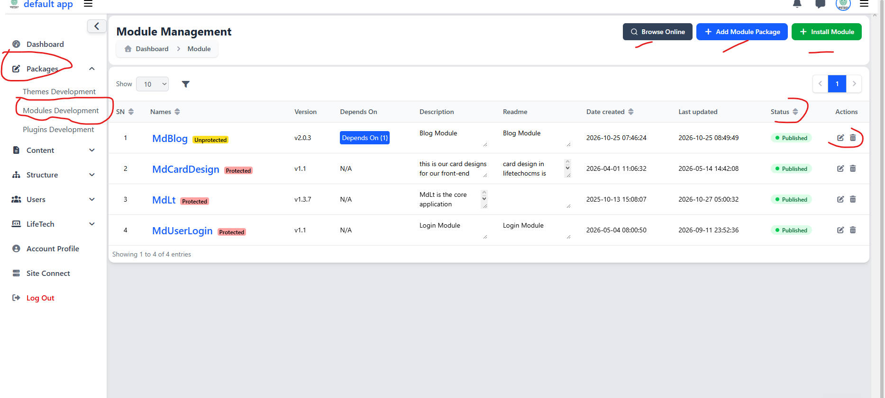

# Accessing Modules Development

[Previous](module-development-overview.md) · [Main documentation](../README.md) · [Guide contents](README.md) · [Next](module-development-conventions.md)

*Section: Getting started*

## Introduction

LifeTechOCMS provides a **Modules Development** interface where developers can access, create, install, and manage module packages.

This guide explains how to navigate to the Module Management page and introduces the available management functions.

## Accessing Module Management

1. Sign in to your LifeTechOCMS administration dashboard.
2. Locate **Packages** in the left navigation menu.
3. Expand **Packages** to display the package development options.
4. Select **Modules Development**.
5. The **Module Management** page will appear.

The page displays registered modules and the available module management actions.

## Understanding the Module Management Interface

### Main Actions

At the top-right corner of the Module Management page, three actions are available.

| Action | Description |
|---|---|
| **Browse Online** | Opens the online module browsing feature for discovering available modules. |
| **Add Module Package** | Opens the interface for creating a new module package. |
| **Install Module** | Opens the module installation process. |

Detailed instructions for creating and installing modules are provided in subsequent lessons.

### Registered Modules

The Module Management table displays modules registered in the LifeTechOCMS installation.

| Column | Description |
|---|---|
| SN | Serial number of the displayed record. |
| Names | Registered module package name. |
| Version | Module version information. |
| Depends On | Displays dependency information where applicable. |
| Description | Brief description of the module. |
| Readme | README information associated with the module. |
| Date created | Date and time the module record was created. |
| Last updated | Date and time the module record was last updated. |
| Status | Displays the module's publication status. |
| Actions | Provides available management actions for the module. |

For example, the screenshot shows `MdBlog`, `MdCardDesign`, `MdLt`, and `MdUserLogin` in the module list.

### Package Protection and Publication Status

The interface displays package protection labels such as **Protected** and **Unprotected** beside module names. It also displays publication status indicators such as **Published**.

These indicators identify package protection and publication information. The precise permissions and restrictions associated with these states depend on the framework's implementation.

### Managing Existing Modules

Each module row contains available action icons, including editing and deletion controls. Verify the selected module and any applicable restrictions before performing management operations, particularly deletion.

### Searching and Browsing Modules

The module list includes a page-size selector, a filter control, sortable column headings, and pagination. These controls help developers inspect and navigate registered module records.

## Next Step

Continue to [Module Development Conventions](module-development-conventions.md) to learn the naming rules and development standards used when creating LifeTechOCMS modules.

---

[Previous](module-development-overview.md) · [Main documentation](../README.md) · [Guide contents](README.md) · [Next](module-development-conventions.md)
