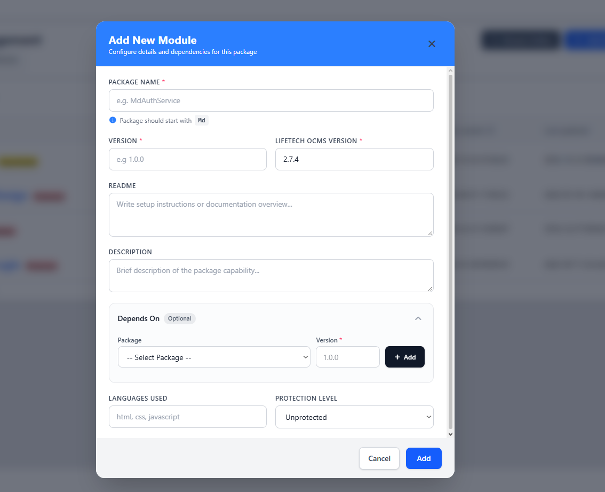

# Add a Module Package

[Previous](module-development-conventions.md) · [Main documentation](../../README.md) · [Guide contents](README.md) · [Next](understand-module-folders-and-subfolders.md)

*Section: Getting started*

LifeTechOCMS provides three ways to add a module package to your installation:

1. **Add Module Package** — create a new module from scratch.
2. **Install Module** — install an existing module package shared with you.
3. **Browse Online** — find a module through the LifeTechOCMS marketplace.

To access these options, open **Packages → Modules Development** in the administration interface. The three actions appear at the top of the Module Management page.

## Create a new module package

Choose **Add Module Package** to create a new module within your LifeTechOCMS installation. The **Add New Module** form appears.

Complete the form as follows:

| Field | Description |
| --- | --- |
| **Package Name** (required) | A PascalCase module name beginning with `Md`, such as `MdNewsletter` or `MdBlog`. |
| **Version** (required) | The version of the module being created, for example `1.0.0`. |
| **LifeTech OCMS Version** (required) | The LifeTechOCMS version specified for this package. The screenshot shows `2.7.4` as an example. |
| **Readme** | Setup instructions or an overview of the module. |
| **Description** | A short explanation of what the module provides. |
| **Depends On** (optional) | Select another package and specify its required version, then select **Add** to include the dependency. |
| **Languages Used** | Technologies used by the module, such as PHP, HTML, CSS, or JavaScript. |
| **Protection Level** | Select the protection level for the module; the screenshot shows **Unprotected**. |

After completing the required fields, select **Add** at the bottom of the form. Use **Cancel** to close the form without adding the module.

### Example: MdNewsletter

For a newsletter module created from scratch, you might enter:

| Field | Example |
| --- | --- |
| Package Name | `MdNewsletter` |
| Version | `1.0.0` |
| LifeTech OCMS Version | The version supported by your installation |
| Readme | `Newsletter management module for LifeTechOCMS.` |
| Description | `Manage newsletter subscriptions and mailing lists.` |
| Depends On | Leave empty unless another package is required |
| Languages Used | `php, html, css, javascript` |
| Protection Level | `Unprotected` (if appropriate for your project) |

Module names follow the LifeTechOCMS naming convention: the `Md` prefix followed by a PascalCase name. For naming rules, see [Module Development Conventions](module-development-conventions.md).

## Install a module shared with you

Choose **Install Module** when you already have a module package developed and shared by another developer.

1. Open **Packages → Modules Development**.
2. Select **Install Module**.
3. Follow the installation interface to provide the existing module package and complete installation.
4. Review the installed module in the Module Management list.

The provided screenshot does not show the installation dialog, so its exact upload fields, accepted archive format, and confirmation steps are not documented here.

## Add a module from the marketplace

Choose **Browse Online** to discover modules published through the LifeTechOCMS marketplace.

1. Open **Packages → Modules Development**.
2. Select **Browse Online**.
3. Browse available modules and choose the package you want.
4. Follow the marketplace interface to add the selected package to your installation.

The marketplace's individual screens and any approval or dependency prompts are not shown in the supplied screenshot.

## Verify the module

Return to **Module Management** and locate the module in the list. The management table displays information such as its name, version, dependencies, description, creation and update dates, protection status, and publication status.

For the next stage of development, continue to the guide on understanding module folders and subfolders.

---

[Previous](module-development-conventions.md) · [Main documentation](../../README.md) · [Guide contents](README.md) · [Next](understand-module-folders-and-subfolders.md)
