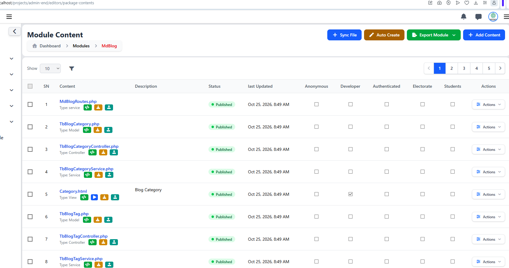
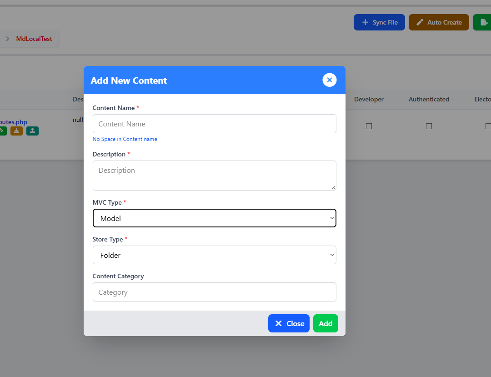

# Add New Module Content

[Previous](module-content-and-resource-types.md) · [Main documentation](../../README.md) · [Guide contents](README.md) · [Next](auto-create-model-controller-service.md)

*Section: Creating module components*

LifeTechOCMS lets developers add content to an existing module through the **Module Content** interface. Each content item is associated with a module and assigned an MVC type so that it can be organized with the module's development resources.

## What is module content?

In LifeTechOCMS, **module content** means an individual development resource registered under a module. It can be a file that helps the module store data, process requests, perform operations, or display information. The **Module Content** page lists these resources so developers can find and manage them in one place.

For example, a blog module might contain:

- **Model — `TbBlogCategory.php`:** works with blog category data.
- **Controller — `TbBlogCategoryController.php`:** handles requests relating to blog categories.
- **Service — `TbBlogCategoryService.php`:** contains operations and business rules for blog categories.
- **View — `CategoryList.html`:** displays category information to visitors or administrators (illustrative filename).

**Content is not necessarily a blog post or page.** Here, it means a development resource belonging to the selected module. When you add content, you choose its type and give it a name so LifeTechOCMS can register it with that module.

## Open the module content list

1. Navigate to **Modules** in the LifeTechOCMS administration interface.
2. Select the module you want to work on, for example **MdLocalTest**.
3. The **Module Content** page displays the content already registered for that module.
4. Click **Add Content** at the top-right of the page to open the **Add New Content** form.

In the example, `MdLocalTestRoutes.php` appears in the list as a published **service**. This route file was created with the module; you do not need to create it again just to add another resource.

## Complete the Add New Content form

The form contains the following fields:

| Field | Description |
| --- | --- |
| **Content Name** (required) | Enter the resource name without spaces. Use the naming convention appropriate to its type. |
| **Description** (required) | Briefly describe what the resource is intended to do. |
| **MVC Type** (required) | Choose one of the four built-in options: **Service**, **Model**, **Controller**, or **View**. |
| **Store Type** (required) | Choose the available storage option. The screenshot shows **Folder** selected. |
| **Content Category** | Optionally enter a category to help classify the content. |

After completing the required fields, click **Add**. Use **Close** if you want to leave the form without adding content.

## Choose an MVC type

The **MVC Type** dropdown offers four default options:

| Type | Purpose | Example name |
| --- | --- | --- |
| **Model** | Represents or works with the module's data. | `TbBlogCategory` |
| **Controller** | Receives application requests and coordinates the response. | `TbBlogCategoryController` |
| **Service** | Holds reusable business logic and operations. | `TbBlogCategoryService` |
| **View** | Provides content for presentation to users. | `CategoryList` |

These four are the built-in choices shown for **MVC Type**. Developers may organize other supporting PHP components, such as contracts, traits, DTOs, or exceptions, in their module code where supported; they are **not** additional default choices in this dropdown.

## Practical example: adding a blog category model

For a module such as `MdBlog`, you could begin by creating a model resource:

1. Open **MdBlog** from the Modules list and click **Add Content**.
2. Set **Content Name** to `TbBlogCategory` (without spaces).
3. Enter a description such as `Represents blog category data`.
4. Choose **Model** under **MVC Type**.
5. Select the appropriate **Store Type** (for example, **Folder** if that is the desired available option).
6. Optionally supply a **Content Category**, then click **Add**.

The naming convention for related resources is `TbBlogCategoryService` for a service and `TbBlogCategoryController` for a controller. Create each as its own content item when working manually. This example illustrates form entry; it does not assume that adding a model automatically generates the other resources.

## Check the content list

Return to the module's content list and confirm that the new item appears with the intended type. The list also shows information such as publication status, last updated time, role-related columns, and an **Actions** menu. The exact available actions and permissions depend on the installation and current user access.

For generating related resources together, continue to [Auto Create Model, Controller, and Service](auto-create-model-controller-service.md).

---

[Previous](module-content-and-resource-types.md) · [Main documentation](../../README.md) · [Guide contents](README.md) · [Next](auto-create-model-controller-service.md)
