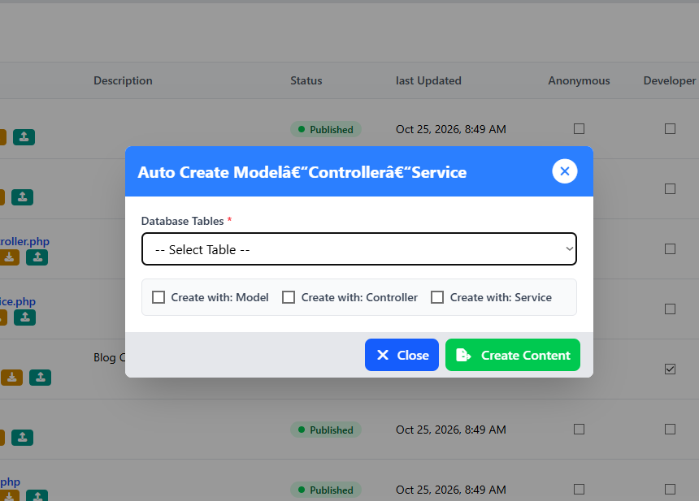

# Auto-Create Model, Controller and Service

[Previous](add-new-module-content.md) · [Main documentation](../../README.md) · [Guide contents](README.md) · [Next](sync-module-files.md)

*Section: Creating module content*

## What is Auto Create?

**Auto Create** is a LifeTechOCMS feature that allows developers to generate module content from an existing database table.

It generates three content types:

- **Model** — handles database-related operations.
- **Controller** — handles incoming requests and coordinates application operations.
- **Service** — contains the business logic for module operations.

Developers can generate one, two, or all three content types.

## How to use Auto Create

1. Navigate to **Modules** in LifeTechOCMS.
2. Select the module you want to work on.
3. On the **Module Content** page, click **Auto Create**.
4. Select an existing table under **Database Tables**.
5. Tick **Create with: Model**, **Create with: Controller**, or **Create with: Service** as required.
6. Click **Create Content**.
7. Review the generated content in your module.



## Example: Creating content from a database table

Suppose your module is named `MdStudent` and your database contains a table named `tb_student`.

Select `tb_student` and tick all three content types.

Following LifeTechOCMS naming conventions, the expected content files are:

```text
MdStudent/
├── Models/
│   └── TbStudent.php
├── Controllers/
│   └── TbStudentController.php
└── Services/
    └── TbStudentService.php
```

These names illustrate the expected naming conventions. Review the actual generated files to confirm their contents.

## Important notes

- The database table must already exist before it can be selected.
- You do not need to generate all three content types.
- Auto Create provides initial content files that developers can extend.
- Review generated code before using it in production.

## What next?

Continue to [Sync Module Files](sync-module-files.md) to learn how module files can be synchronized with their content records.

---

[Previous](add-new-module-content.md) · [Main documentation](../../README.md) · [Guide contents](README.md) · [Next](sync-module-files.md)
  