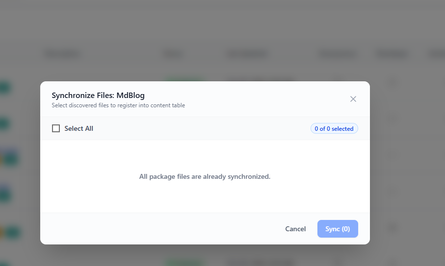

# Sync Module Files

[Previous](auto-create-model-controller-service.md) · [Main documentation](../../README.md) · [Guide contents](README.md) · [Next](understand-the-mvc-architecture.md)

*Section: Creating module content*

## What is Sync Module Files?

**Sync File** registers new module files created directly in a module's folders as **module content** in the LifeTechOCMS database. It is useful when developers write code in a local editor, copy files into an existing module, or generate files with an AI coding tool instead of using **Add Content**.

Syncing is primarily **file-to-database content registration**. It should not be confused with editing the code of an already registered content item.

## Which folders are scanned?

LifeTechOCMS scans these four module folders:

| Folder | Example file | Content type | Purpose |
| --- | --- | --- | --- |
| `Models/` | `TbStudent.php` | Model | Work with data associated with a database table. |
| `Controllers/` | `TbStudentController.php` | Controller | Handle requests and coordinate operations. |
| `Services/` | `TbStudentService.php` | Service | Implement module business operations. |
| `Views/` | `StudentList.php` | View | Present module output or interface content. |

These filenames are illustrative. Use the correct folder, naming conventions, and namespace for your module. Other folders are **not part of the four-folder scan described here**.

## How to synchronize module files

1. Open **Modules** in LifeTechOCMS.
2. Select the module you are working on, for example `MdBlog`.
3. Open its **Module Content** page and click **Sync File**.
4. In the **Synchronize Files** window, review any discovered files that are not yet registered as module content.
5. Tick the files you want to register, or choose **Select All** when appropriate.
6. Click **Sync** to register the selected files.
7. Return to the module content list and verify the newly registered content and its type.



The screenshot shows **0 of 0 selected** and the message **“All package files are already synchronized.”** This means no additional files were offered for registration in that scan. There is nothing to select or sync in this state.

## Example: Register a locally created service

Suppose you are developing `MdStudent` and create this file directly in your project:

```text
packages/modules/MdStudent/Services/TbStudentService.php
```

After saving the file, open **MdStudent → Module Content → Sync File**. If the file is discovered as unregistered content, select it and click **Sync**. Then check that `TbStudentService.php` appears in the module content list as **Service** content.

The file's actual PHP code and namespace must still be valid; syncing a file does not by itself prove that its implementation works.

## Working with AI-generated files

If an AI tool generates module content for you, review the code, put each file into the correct folder of the target LifeTechOCMS installation, and then use **Sync File**. The tool registers files found in the module folders; it does **not** fetch files from an AI chat or another computer.

## Sync File versus other actions

| Action | When to use it |
| --- | --- |
| **Add Content** | Create and register new module content through the LifeTechOCMS interface. |
| **Auto Create** | Generate selected Model, Controller, or Service content from an existing database table. |
| **Sync File** | Register files already placed in the module's scanned folders but not yet registered as content. |
| **Code Editor / local editor** | Edit the implementation of an existing file. |

After synchronizing, review the content's publication and access settings where applicable, and test any affected routes or endpoints. Do not assume synchronization automatically publishes content or creates routes.

## Next step

Continue to [Understand the MVC Architecture](understand-the-mvc-architecture.md) to learn how Model, Controller, Service, and View content work together.

---

[Previous](auto-create-model-controller-service.md) · [Main documentation](../../README.md) · [Guide contents](README.md) · [Next](understand-the-mvc-architecture.md)
