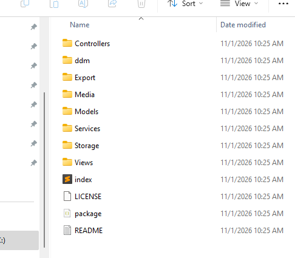

# Understand Module Folders and Subfolders

[Previous](add-module-package.md) · [Main documentation](../../README.md) · [Guide contents](README.md) · [Next](module-content-and-resource-types.md)

*Section: Getting started*

When you create a new module in LifeTechOCMS, the system prepares a starting folder structure for the package. This guide uses the newly generated `MdLocalTest` module as an example and explains where to place code, resources, and optional developer-defined components.

## Default module structure



The newly created `MdLocalTest` package has the following main folders. Only the automatically generated route file is shown inside a folder:

```text
MdLocalTest/
├── Controllers/
├── ddm/
├── Export/
├── Media/
├── Models/
├── Services/
│   └── MdLocalTestRoutes.php
├── Storage/
├── Views/
├── index.php
├── LICENSE
├── package.json
└── README.md
```

The structure above focuses on the module's main folders. Their internal files and subfolders are intentionally omitted, apart from the generated route file.

## What each folder is for

| Folder | Role in module development |
| --- | --- |
| `Controllers/` | Request-handling controller classes. Use PascalCase filenames ending in `Controller.php`, such as `TbBlogCategoryController.php`. |
| `Models/` | Database-facing model classes. Name each model from its `tb_` table: `tb_blog_category` becomes `TbBlogCategory.php`. |
| `Services/` | Business logic, reusable operations, and the generated module route file, such as `MdLocalTestRoutes.php`. Business service classes end in `Service.php`. |
| `Views/` | Module view templates or presentation resources, where applicable. |
| `Media/` | A location for module-associated media resources. |
| `Export/` | Stores resources used when exporting a module package. |
| `ddm/` | Holds LifeTechOCMS module definition and resource files. |
| `Storage/` | Stores module-specific supporting data and configuration. |

The module root also contains `package.json` for package metadata, `README.md` for developer documentation, `LICENSE` for licensing information, and `index.php`. These files are listed for orientation; this lesson focuses on folder organisation.

**Generated route file:** `Services/MdLocalTestRoutes.php` is created when the module package is generated. It connects module routes to controller actions. Route definitions are explained in the separate routes lesson.

## Organise your PHP code using namespaces

LifeTechOCMS module classes use the `Lt\Modules` namespace, followed by the module name and the relevant component directory. For example:

```php
<?php

namespace Lt\Modules\MdBlog\Services;

class NewsletterService
{
    public function send(): bool
    {
        return true;
    }
}
```

This illustrates namespace and class naming, not an actual email-sending implementation. A corresponding file would be `MdBlog/Services/NewsletterService.php`.

## Add your own folders and components

The generated structure is a starting point, **not a restriction on the types of PHP components you can create**. As your module grows, you may add directories such as `Traits/`, `Contracts/`, `Interfaces/`, `DTOs/`, or `Exceptions/` when they improve organisation.

Use **PascalCase** for these component directory names, class names, interface names, trait names, and their PHP filenames. Keep each PHP namespace aligned with its directory. For example, a developer may extend a module with additional folders:

```text
MdBlog/
├── Contracts/
├── Traits/
├── Interfaces/
├── DTOs/
└── Exceptions/
```

These are optional developer-created folders, not part of the default generated structure. The PHP files placed in them should use PascalCase filenames and namespaces matching their locations.

### Example: a contract (interface)

`Contracts/PostPublisherInterface.php`:

```php
<?php

namespace Lt\Modules\MdBlog\Contracts;

interface PostPublisherInterface
{
    public function publish(int $postId): bool;
}
```

### Example: a reusable trait

`Traits/HasPublishStatus.php`:

```php
<?php

namespace Lt\Modules\MdBlog\Traits;

trait HasPublishStatus
{
    public function isPublished(string $status): bool
    {
        return $status === 'published';
    }
}
```

### Example: use both in a service

`Services/PostPublisherService.php`:

```php
<?php

namespace Lt\Modules\MdBlog\Services;

use Lt\Modules\MdBlog\Contracts\PostPublisherInterface;
use Lt\Modules\MdBlog\Traits\HasPublishStatus;

class PostPublisherService implements PostPublisherInterface
{
    use HasPublishStatus;

    public function publish(int $postId): bool
    {
        // Replace with your module's persistence and validation logic.
        return $postId > 0;
    }
}
```

The `use` imports resolve the classes and traits by namespace. PHP does not automatically discover new files simply because they exist in a directory: ensure your module's autoloading or framework class-loading configuration supports the new namespaces and file paths. The sample `publish()` method is illustrative and does not update a database.

## Recommended organisation practices

- Keep request handling in controllers, database access in models, and business operations in services.
- Follow the established `Md` module prefix and PascalCase PHP component naming conventions.
- Create additional folders only when they have a clear responsibility; avoid placing unrelated classes together.
- Preserve the generated module structure and route file unless you understand their role.
- Document any custom directories and external dependencies in `README.md`.

For a practical existing module, see [MdBlog](https://github.com/adedayoAdetunji/MdBlog). For more naming rules, read [Module Development Conventions](module-development-conventions.md).

---

[Previous](add-module-package.md) · [Main documentation](../../README.md) · [Guide contents](README.md) · [Next](module-content-and-resource-types.md)
