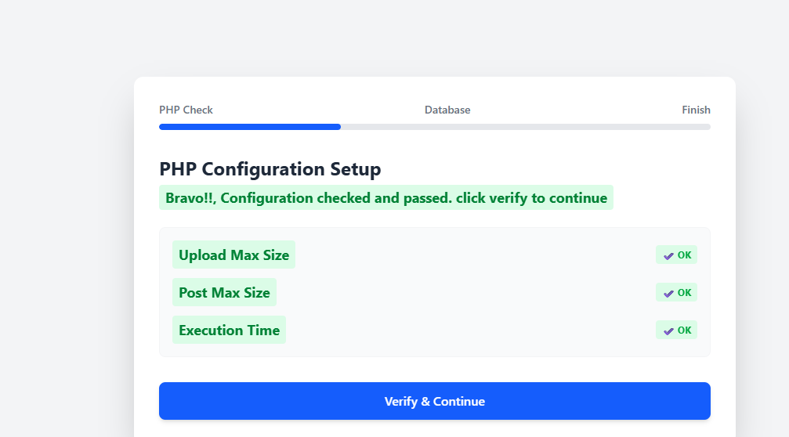
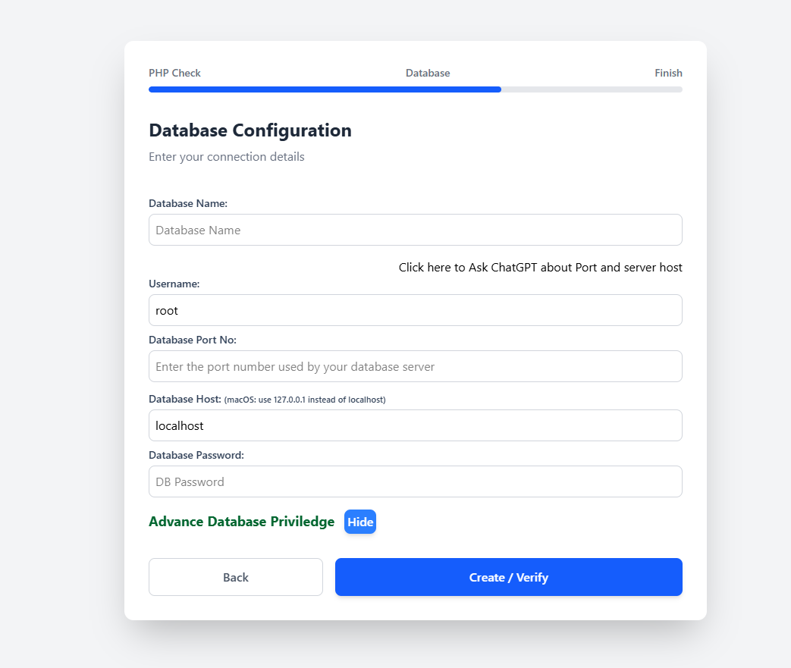
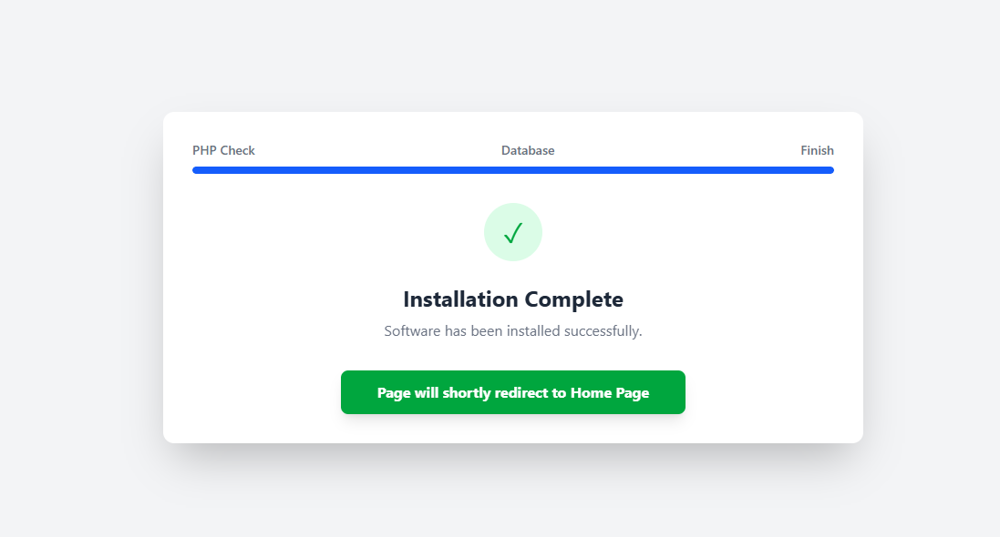

[← Previous: Downloading and Running LifeTech OCMS](02-download-and-run.md) | [Back to Get Started](README.md) | [Next: First Run, Administration and Next Steps →](04-first-run-and-admin.md)

---

# Installation Process


## On this page

- [4.1 Method A — Three-step installation wizard (non-Docker)](#41-method-a--three-step-installation-wizard-non-docker)
- [4.2 Method B — Docker installation (no browser wizard)](#42-method-b--docker-installation-no-browser-wizard)

## 4.1 Method A — Three-step installation wizard (non-Docker)

### Step 1 — PHP Configuration Setup

1. Open the application URL.
2. Review Upload Max Size, Post Max Size and Execution Time.
3. If a check fails, update the active PHP configuration and restart the relevant service.
4. When all checks show OK, select Verify & Continue.

### Step 2 — Database Configuration

1. Enter your proposed database name.
2. For a typical local setup, retain the displayed host, username, port and password only if they match your actual database server.
3. Use Create / Verify to create or verify the connection.

The form includes Database Name, Username, Database Port No., Database Host, Database Password and an Advanced Database Privilege option. Some macOS configurations may need 127.0.0.1 instead of localhost. Do not assume an empty password is safe outside local development.

### Step 3 — Finish

When installation succeeds, the wizard displays Installation Complete and automatically redirects to the homepage. Confirm that the site loads before signing in to /admin.

*Figure 1 — PHP configuration verification*



*Figure 2 — Database configuration*



*Figure 3 — Installation complete*



## 4.2 Method B — Docker installation (no browser wizard)

For Docker installations, configure the .env file before building. The Compose configuration must provide the required application and database services and initialisation steps. The sample below is based on the supplied LifeTech OCMS environment file; change example credentials before deployment.

| Setting | Example | Purpose |
| --- | --- | --- |
| APP_NAME | lifetechocms_main | Application name |
| APP_PORT | 8080 | Host port for website |
| PHPMYADMIN_PORT | 8081 | Host port for phpMyAdmin |
| MYSQL_PORT | 3307 | Host database port |
| MYSQL_DATABASE / LT_DB_NAME | lifetech_demo | Must refer to same database |
| MYSQL_USER / LT_DB_USER | lifetech_user | Must refer to same user |
| MYSQL_PASSWORD / LT_DB_PASS | Choose strong matching values | Database user password |
| MYSQL_ROOT_PASSWORD | Choose a separate strong password | Database root password |
| LT_DB_HOST | db | Docker Compose database service hostname |

1. Open .env and update the application name, port and database name.
2. Keep matching database name, user and password pairs consistent between MYSQL_* and LT_DB_* settings.
3. From the project directory, build and start the containers.
```bash
docker compose up -d --build
```

4. Open the homepage and then /admin.
```text
http://localhost:8080/
```

```text
http://localhost:8080/admin
```

If APP_PORT is different, replace 8080 in the URLs. Existing Docker database volumes may retain older settings; changing .env alone may not recreate an existing database or user. Avoid deleting volumes without a backup.

---

[← Previous: Downloading and Running LifeTech OCMS](02-download-and-run.md) | [Back to Get Started](README.md) | [Next: First Run, Administration and Next Steps →](04-first-run-and-admin.md)
